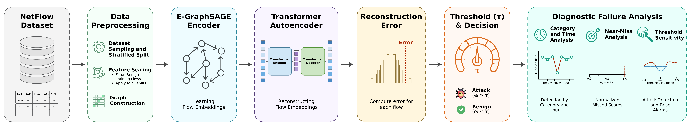

# Reproduction and Threshold Calibration Analysis of Self-Supervised Graph Network Intrusion Detection

**Authors:** Muhammad Usman Ashraf and Adeel Anjum  
Institute of Information Technology, Quaid-i-Azam University, Islamabad, Pakistan  
International Conference on Frontiers of Information Technology (FIT), 2026

We reproduced [GraphIDS](https://github.com/lorenzo9uerra/GraphIDS) on four NetFlow benchmarks using the authors' PyTorch Geometric implementation on an Apple M1 Pro CPU. We then analyzed detection failures on NF-CSE-CIC-IDS2018-v3 using a seed-24 checkpoint and 402,311 test flows from a stratified 20% dataset sample.

The original GraphIDS study reported difficulty detecting Infiltration. In our evaluated subset, GraphIDS detects 94.44% of all attacks but only 23.09% of Infiltration flows. We examine when the missed attacks occur, how close their reconstruction scores are to the decision threshold, and how many benign flows are flagged when the threshold is lowered.

## Pipeline overview

Figure 1 shows how GraphIDS produces a score for each flow. An E-GraphSAGE encoder generates flow embeddings, a transformer autoencoder reconstructs them, and GraphIDS flags a flow when its reconstruction error exceeds the checkpoint threshold. Our analysis links each score to its original flow record and measures detection by attack category, UTC hour, and threshold setting.

<p align="center">
  
</p>

## Repository structure

The tree shows the working directory after the required inputs have been placed. The repository includes the source code, configurations, checkpoints, workflow figure, baseline logs, reference results, and `artifacts/aligned_scores.csv`. For checkpoint inference, readers download the processed-cache ZIP from Google Drive and place it in the repository root. Raw datasets are downloaded separately from the dataset provider.

```text
graphids-failure-analysis/
├── README.md
├── LICENSE                                  # MIT license for our contributions
├── pyproject.toml                           # CPU environment tested on Apple Silicon
├── uv.lock                                  # Locked dependency versions
├── main.py                                  # GraphIDS training and evaluation
│
├── analysis/
│   └── run_analysis.py                      # Score alignment, diagnostics, and Figures 2–4
│
├── checkpoints/
│   ├── GraphIDS_NF-UNSW-NB15-v2_24.ckpt
│   ├── GraphIDS_NF-UNSW-NB15-v3_24.ckpt
│   ├── GraphIDS_NF-CSE-CIC-IDS2018-v2_24.ckpt
│   └── GraphIDS_NF-CSE-CIC-IDS2018-v3_24.ckpt
│
├── configs/
│   ├── NF-UNSW-NB15-v2.yaml
│   ├── NF-UNSW-NB15-v3.yaml
│   ├── NF-CSE-CIC-IDS2018-v2.yaml
│   └── NF-CSE-CIC-IDS2018-v3.yaml
│
├── models/
│   ├── __init__.py
│   └── graphids.py
│
├── utils/
│   ├── __init__.py
│   ├── dataloaders.py
│   ├── parser.py
│   ├── shift_segments.py
│   └── trainers.py
│
├── tests/
│   ├── conftest.py
│   ├── test_config.py
│   ├── test_data_utils.py
│   ├── test_preprocessing.py
│   └── test_training_and_evaluation.py
│
├── figures/
│   └── full_pipeline.png                    # Figure 1
│
├── results/
│   ├── baseline/                            # Historical training runs for Table II
│   │   ├── NF-UNSW-NB15-v2.txt
│   │   ├── NF-UNSW-NB15-v3.txt
│   │   ├── NF-CSE-CIC-IDS2018-v2.txt
│   │   └── NF-CSE-CIC-IDS2018-v3.txt
│   └── reference/                           # Expected diagnostic results and input hashes
│       ├── summary.json
│       ├── detection_by_attack_type.csv
│       ├── threshold_sensitivity.csv
│       └── checkpoint_input_hashes.json
│
├── artifacts/
│   └── aligned_scores.csv                   # Saved flow scores included in this repository
│
└── data/
    ├── NF-UNSW-NB15-v2/
    │   └── NF-UNSW-NB15-v2.csv
    ├── NF-UNSW-NB15-v3/
    │   └── NF-UNSW-NB15-v3.csv
    ├── NF-CSE-CIC-IDS2018-v2/
    │   └── NF-CSE-CIC-IDS2018-v2.csv
    ├── NF-CSE-CIC-IDS2018-v3/
    │   └── NF-CSE-CIC-IDS2018-v3.csv
    └── pyg_graph_data/
        └── NF-CSE-CIC-IDS2018-v3_0_2/      # Extracted cache downloaded from Google Drive
            ├── .seed                        # Contains 24
            ├── train.pt
            ├── val.pt
            ├── test.pt
            └── scaler.pkl
```

## Setup

Install [uv](https://docs.astral.sh/uv/) and run:

```bash
git clone https://github.com/m-usmanashraf/graphids-failure-analysis.git
cd graphids-failure-analysis
uv python install 3.12
uv sync --python 3.12 --locked
uv run --locked pytest tests/ -q
```

Run all remaining commands from the repository root. Choose the workflow that matches your goal.

| Workflow | What it reproduces | Inputs |
|---|---|---|
| 1. Analyze saved scores | The paper's diagnostic results and Figures 2–4 | `artifacts/aligned_scores.csv`, included in this repository |
| 2. Run checkpoint inference | Per-flow reconstruction scores, metadata alignment, and diagnostics | CSE-v3 checkpoint, raw CSE-v3 CSV, and original processed cache |
| 3. Retrain the four models | Training and evaluation for the four benchmark configurations | All four raw dataset CSVs and the supplied YAML configurations |

The checkpoint analysis was run on macOS using an Apple M1 Pro CPU, Python 3.12.13, PyTorch 2.4.0, and PyTorch Geometric 2.6.1. The scaler was saved with scikit-learn 1.7.2 and loaded with 1.9.0 during the diagnostic run. Loading produced a version warning, and the transformed edge features matched those in the cached test graph.

## 1. Reproduce the paper's diagnostics from saved scores

The saved scores are included at `artifacts/aligned_scores.csv` and are downloaded when you clone this repository. This workflow regenerates the diagnostic tables and Figures 2–4 directly from those scores.

```bash
uv run --locked python analysis/run_analysis.py analyze \
  --input artifacts/aligned_scores.csv \
  --out results/from_scores
```

Expected final line:

```text
SUCCESS. Outputs: results/from_scores
```

The file `artifacts/aligned_scores.csv` contains **402,311 data rows**. To verify its SHA-256 on macOS, run:

```bash
shasum -a 256 artifacts/aligned_scores.csv
```

Expected SHA-256:

```text
5d557c64560d4375e070882df08ccb9e6125e0492da46defddc739b4a5a13288
```

Compare the generated `summary.json`, `detection_by_attack_type.csv`, and `threshold_sensitivity.csv` with the files in `results/reference/`. The output directory also contains hourly results, missed-score ratios, and a `provenance.json` recording the input hash and software versions.

The generated `figures/` subdirectory contains the following plots in PDF and PNG formats:

| Paper figure | Output filename |
|---|---|
| Figure 2 — Detection and false-positive rates by UTC hour | `temporal_detection.pdf` |
| Figure 3 — Normalized score distributions and near-misses | `score_diagnostics.pdf` |
| Figure 4 — Threshold sensitivity | `threshold_tradeoff.pdf` |

Figure 1 is the separately drawn pipeline overview. The analysis script requires a new `--out` directory for each run.

## Datasets for checkpoint inference and training

Download the datasets from the [University of Queensland NIDS dataset collection](https://staff.itee.uq.edu.au/marius/NIDS_datasets/).

Workflow 1 uses saved scores and requires no raw datasets. Workflow 2 requires NF-CSE-CIC-IDS2018-v3. Retraining all four models requires all four datasets.

From the repository root, extract each ZIP into its dataset folder:

```bash
unzip -j <filename>.zip -d data/<dataset_name>
```

Replace `<filename>` with the downloaded archive's filename and `<dataset_name>` with the corresponding benchmark name.

For example, if the NF-UNSW-NB15-v3 archive is in your Downloads folder:

```bash
mkdir -p data/NF-UNSW-NB15-v3

unzip -j "$HOME/Downloads/f7546561558c07c5_NFV3DATA-A11964_A11964.zip" \
  -d data/NF-UNSW-NB15-v3
```

The code expects the following CSV paths:

- `data/NF-UNSW-NB15-v2/NF-UNSW-NB15-v2.csv`
- `data/NF-UNSW-NB15-v3/NF-UNSW-NB15-v3.csv`
- `data/NF-CSE-CIC-IDS2018-v2/NF-CSE-CIC-IDS2018-v2.csv`
- `data/NF-CSE-CIC-IDS2018-v3/NF-CSE-CIC-IDS2018-v3.csv`

If a CSE archive contains the shorter filename `NF-CICIDS2018-v2.csv` or `NF-CICIDS2018-v3.csv`, rename the extracted CSV to match the expected path:

```bash
mv data/NF-CSE-CIC-IDS2018-v2/NF-CICIDS2018-v2.csv \
   data/NF-CSE-CIC-IDS2018-v2/NF-CSE-CIC-IDS2018-v2.csv

mv data/NF-CSE-CIC-IDS2018-v3/NF-CICIDS2018-v3.csv \
   data/NF-CSE-CIC-IDS2018-v3/NF-CSE-CIC-IDS2018-v3.csv
```

Run a rename command only when the extracted file has the shorter name.

## 2. Recompute scores from the checkpoint

Prepare the raw **NF-CSE-CIC-IDS2018-v3** CSV as described above. Use the supplied `GraphIDS_NF-CSE-CIC-IDS2018-v3_24.ckpt` checkpoint.

Download the [processed cache ZIP from Google Drive](https://drive.google.com/file/d/1Ly3Tq5dJ2W_Td4XLjhtAYHAFZMCkdU3Y/view?usp=sharing) and extract it.

Place the extracted `NF-CSE-CIC-IDS2018-v3_0_2` folder inside the repository's `data/pyg_graph_data/` directory, as shown in the tree. Include all five files, including the hidden `.seed` file.

Finder may name the extracted outer folder `data 2` if a `data` folder already exists. You can manually move the cache folder from `data 2/pyg_graph_data/` into `data/pyg_graph_data/`.

Alternatively, place `data 2` in the repository root and run:

```bash
mkdir -p data/pyg_graph_data
cp -R "data 2/pyg_graph_data/NF-CSE-CIC-IDS2018-v3_0_2" data/pyg_graph_data/
```

From the repository root, verify the cache files and saved seed:

```bash
ls -la data/pyg_graph_data/NF-CSE-CIC-IDS2018-v3_0_2/
cat data/pyg_graph_data/NF-CSE-CIC-IDS2018-v3_0_2/.seed
```

The folder should contain `train.pt`, `val.pt`, `test.pt`, `scaler.pkl`, and `.seed`. The seed file should contain `24`.

Run checkpoint inference and analysis:

```bash
uv run --locked python analysis/run_analysis.py checkpoint \
  --out results/from_checkpoint
```

The script preserves each scored edge's identifier and reconstructs its corresponding raw dataset row. It checks the transformed edge features and binary labels against the cached test graph and verifies the IP-to-node mapping. Expected alignment messages:

```text
PASS: all edge features and binary labels match the cached graph.
PASS: IP/node mapping is one-to-one.
```

Expected final line:

```text
SUCCESS. Outputs: results/from_checkpoint
```

Checkpoint mode reads the threshold from the checkpoint and writes `scores.csv`, `aligned_scores.csv`, diagnostic tables, figures, and provenance. Reference input hashes are recorded in `results/reference/checkpoint_input_hashes.json`.

Evaluation uses shuffled edge batches, so fresh inference passes can produce slightly different scores. Workflow 1 reproduces the diagnostics from the exact scores used in the paper.

## Expected diagnostic results

The evaluated test subset contains **350,293 benign flows** and **52,018 attack flows**. GraphIDS flags a flow when its reconstruction error exceeds the checkpoint threshold of `3.4440622584952507e-06`.

| Threshold multiplier | Macro F1 | Attack detection | False positives | Benign false-positive rate | Missed attacks |
|---|---:|---:|---:|---:|---:|
| 0.50 | 0.50563 | 99.46% | 181,887 | 51.92% | 279 |
| 0.75 | 0.92592 | 94.60% | 11,560 | 3.30% | 2,808 |
| 1.00 | 0.96352 | 94.44% | 3,762 | 1.07% | 2,894 |

- **Overall performance.** At the checkpoint threshold, the confusion matrix in benign/attack order is `[[346531, 3762], [2894, 49124]]`. Attack-class average precision is 0.88852.
- **Attack category.** All 2,894 missed attacks belong to Infiltration. GraphIDS detects 869 of 3,763 Infiltration flows (23.09%) and all 48,255 attack flows in the other 13 categories. The raw CSV spells the category `Infilteration`.
- **Time.** Misses occur in 20 of the 53 UTC calendar hours containing attacks. There are 1,493 misses on 28 February 2018 and 1,401 on 1 March 2018. The two hours with the most misses account for 29.44% of all misses.
- **Near-misses.** Of the 2,894 missed attacks, 2,615 (90.36%) have scores above half the checkpoint threshold and at or below the checkpoint threshold. Halving the threshold recovers these 2,615 attacks and produces 178,125 additional false positives.
- **Score distributions.** Median reconstruction error divided by the checkpoint threshold is 0.547 for Infiltration and 0.501 for benign traffic. With Infiltration as the positive class, Infiltration-versus-benign ROC-AUC is 0.799.

These diagnostics describe one checkpoint and one evaluated test subset. Attack category and time are confounded in the missed flows. The threshold sweep measures attack recovery and false alarms using a fixed set of reconstruction scores.

## 3. Optional: train the four benchmark models

Prepare the four raw CSVs at the paths in the repository tree. The released YAML configurations specify no subsampling for the two UNSW variants and a stratified 20% sample before splitting for the two CSE variants.

Use a fresh checkpoint directory when starting new training runs. `main.py` can load an existing checkpoint at the specified path. The commands below save new checkpoints under `results/retraining/checkpoints/`.

```bash
(
  set -e
  for dataset in NF-UNSW-NB15-v2 NF-UNSW-NB15-v3 NF-CSE-CIC-IDS2018-v2 NF-CSE-CIC-IDS2018-v3
  do
    uv run --locked python main.py \
      --data_dir data \
      --dataset "$dataset" \
      --config "configs/$dataset.yaml" \
      --seed 24 \
      --checkpoint "results/retraining/checkpoints/GraphIDS_${dataset}_24.ckpt"
  done
)
```

The original CPU reproduction runs reported in Table II produced:

| Dataset | Macro F1 (%) | Attack AP (%) |
|---|---:|---:|
| NF-UNSW-NB15-v2 | 95.15 | 83.70 |
| NF-UNSW-NB15-v3 | 99.98 | 100.00 |
| NF-CSE-CIC-IDS2018-v2 | 95.90 | 94.91 |
| NF-CSE-CIC-IDS2018-v3 | 96.35 | 88.87 |

The separate CSE-v3 inference pass used for the failure analysis produced 96.352% macro F1 and 88.852% attack AP. The four historical training logs are provided under `results/baseline/`.

## Citation

If you use this repository, our trained checkpoints, or our failure-analysis code, please cite our paper. The proceedings details will be updated after publication.

```bibtex
@inproceedings{ashraf2026graphids,
  author    = {Ashraf, Muhammad Usman and Anjum, Adeel},
  title     = {Reproduction and Threshold Calibration Analysis of Self-Supervised Graph Network Intrusion Detection},
  booktitle = {[Final proceedings title to be added after publication]},
  year      = {2026},
  note      = {Accepted at the International Conference on Frontiers of Information Technology (FIT 2026)}
}
```

Our reproduction uses the GraphIDS architecture and implementation developed by Guerra et al. If you use these components, please also cite the original study:

```bibtex
@inproceedings{guerra2025graphids,
  author    = {Guerra, Lorenzo and Chapuis, Thomas and Duc, Guillaume and Mozharovskyi, Pavlo and Nguyen, Van-Tam},
  title     = {Self-Supervised Learning of Graph Representations for Network Intrusion Detection},
  booktitle = {Advances in Neural Information Processing Systems},
  volume    = {38},
  pages     = {109471--109501},
  year      = {2025}
}
```

## License

Our failure-analysis code (`analysis/run_analysis.py`) and the four checkpoints we trained are released under the MIT License. See [`LICENSE`](LICENSE).

The original GraphIDS code retains its Apache 2.0 license and upstream attribution. See the [original GraphIDS repository](https://github.com/lorenzo9uerra/GraphIDS). The dataset provider's terms apply to the data.
